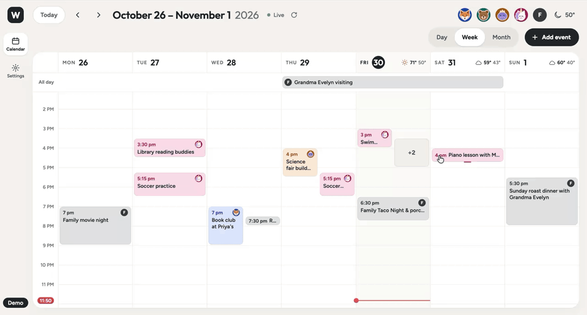
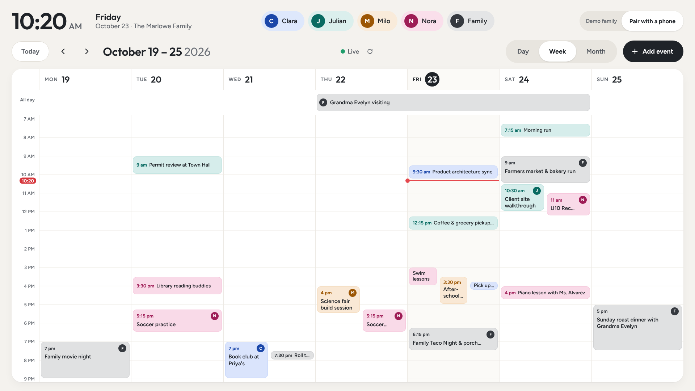
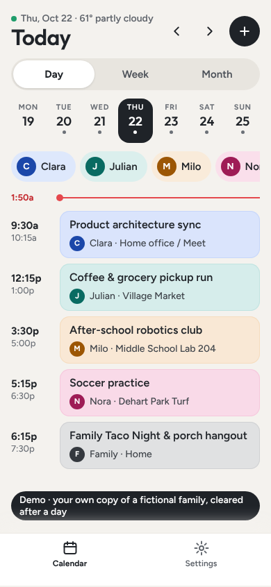
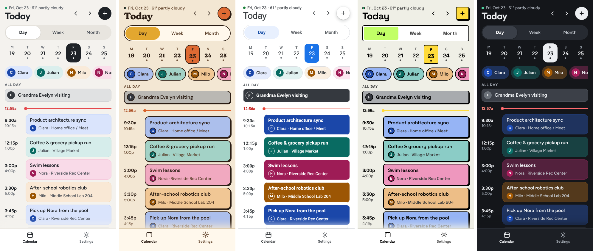
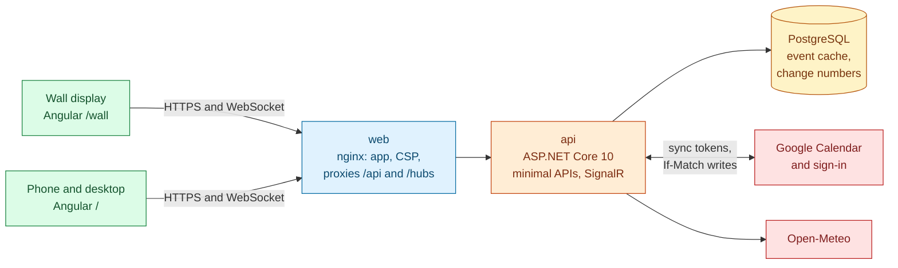

# Wheelhouse

A family calendar for the kitchen wall and every phone in the house, built on the family's own Google Calendar.

[](https://github.com/natezimm/wheelhouse/actions/workflows/release.yml)
[](https://github.com/natezimm/wheelhouse/releases)
[](LICENSE)
[](https://calendar.nathanzimmerman.com)



**[Try the live demo](https://calendar.nathanzimmerman.com)**: you get your own private copy of the fictional Marlowe family, no sign-in needed, cleared after a day. Open [`/wall`](https://calendar.nathanzimmerman.com/wall) for the wall display, and `/` on a phone.

## What it does

- **A wall display** (a 1920 × 1080 touch screen in kiosk mode) with Day, Week and Month views, each person's events in their own color, today's weather and countdown chips for big days.
- **A phone and desktop calendar** at `/`: a Settings button beside the view switch on a phone, a side rail from 768 px, and keyboard shortcuts on a desktop.
- **Edit from anywhere.** Add, change, duplicate and delete events, drag them to another time or day, pull an edge to change the length, and set repeats from "every weekday" to "the second Tuesday, ten times". Undo for ten seconds after changing or deleting one event.
- **Live everywhere.** A change on one screen appears on every other within a second or two, and edits made in Google's own apps arrive within two minutes.
- **Family settings** on the phone: members and their colors and pictures, which Google calendars show and whose they are, paired wall displays, private events, and four themes (Daylight, Groovy, Classic, Bold), each with a night look.

<p>
  
  
</p>

<p>
  
</p>

## Engineering highlights

- **Google Calendar is the source of truth.** The API keeps a cache that it syncs with Google's incremental sync tokens, and every write goes to Google first with the cached etag in `If-Match`. Each change also sends back the version of the event it was made from, so a draft opened before someone else's save gets their version back as a 409 instead of overwriting it, and so does a change made in Google first. ([ADR 0001](docs/adr/0001-google-calendar-is-the-source-of-truth.md), [`EventEndpoints.cs`](src/Wheelhouse.Api/Calendar/EventEndpoints.cs))
- **Optimistic edits with idempotent retries.** The screen draws a change at once over the last confirmed snapshot and rolls back only the edit that failed. A save that timed out offers Check save, which reads the day before retrying, and a retried create reuses the same `creationId`, which maps to one deterministic Google event id, so it cannot make a duplicate. ([`calendar.ts`](web/src/app/core/calendar.ts), [`EventIdentity.cs`](src/Wheelhouse.Api/Calendar/EventIdentity.cs))
- **Live updates from committed change numbers.** Each family has a change number that advances in the same transaction as the calendar change. A background service publishes committed numbers over SignalR, carrying no event data, and clients fetch their visible days, so only committed state is ever announced and the read path's privacy rules are the only ones. ([ADR 0003](docs/adr/0003-per-family-change-numbers.md))
- **Family isolation by default.** Every family-owned table gets an EF Core query filter on the signed-in family, so a query that forgets the family returns nothing rather than someone else's events. ([ADR 0002](docs/adr/0002-family-scoping-in-the-db-context.md), [`WheelhouseDbContext.cs`](src/Wheelhouse.Api/Data/WheelhouseDbContext.cs))
- **Staged, automatic releases.** Every merge to `main` is tested again, tagged, built into images and deployed to the demo first; only after the demo passes a browser smoke check do the family instances move. Each deploy snapshots the database first, and backups go to Cloud Storage nightly. ([`release.yml`](.github/workflows/release.yml), [deploy guide](deploy/README.md))

## Architecture



[docs/architecture.md](docs/architecture.md) has the system context, the containers in more detail, the sequence of an optimistic edit and its live notification, and the delivery pipeline. The reasoning behind the main choices is in [docs/adr/](docs/adr/).

## Tech stack

| Layer | Technology |
| --- | --- |
| Web | Angular 22 (standalone components, signals, zoneless), one app with wall and phone layouts |
| API | ASP.NET Core 10 minimal APIs by feature folder, SignalR, Data Protection |
| Data | PostgreSQL with EF Core migrations |
| Integrations | Google Calendar REST API and Google sign-in, Open-Meteo |
| Tests | xUnit with Testcontainers PostgreSQL, Angular unit tests, Playwright |
| Delivery | GitHub Actions, GitHub Container Registry, Docker Compose, nginx |

## Run it locally

You need Docker with Compose.

```bash
docker compose up --build -d
```

Open http://localhost:8080 for the phone layout (or the desktop layout in a window 768 px or wider) and http://localhost:8080/wall for the wall display. Locally the app runs as the demo, so you get your own copy of the Marlowe family without signing in. `http://localhost:8080/health` reports whether the API can reach its database. `docker compose down` stops it and keeps the database volume; add `--volumes` to delete it.

### From source

You need the .NET 10 SDK and Node 24 or later. Start only the database in Docker, then run the API and the web app.

```bash
docker compose up db -d
dotnet run --project src/Wheelhouse.Api
```

In a second terminal:

```bash
cd web
npm ci
npm start
```

Open http://localhost:4200. The dev server forwards `/api`, `/hubs` and `/health` to the API on port 5080. To use other ports or another database password, set `WHEELHOUSE_HTTP_PORT`, `WHEELHOUSE_DB_PORT` or `WHEELHOUSE_DB_PASSWORD` before `docker compose up`; if you change the password, set `ConnectionStrings__Wheelhouse` to match when you run the API from source.

### As a private family instance

To try Google sign-in instead of the demo, create a Google OAuth client as [deploy/README.md](deploy/README.md#google-sign-in) describes, with `http://localhost:8080/api/auth/google/callback` as a redirect URI, and start the app with these set in your shell or in a `.env` file next to `compose.yaml` (never committed):

```
WHEELHOUSE_MODE=Family
WHEELHOUSE_GOOGLE_CLIENT_ID=<client id>
WHEELHOUSE_GOOGLE_CLIENT_SECRET=<client secret>
WHEELHOUSE_PARENT_EMAILS=<your address>
```

## Tests and quality

Every pull request runs three jobs, and every merge to `main` runs them again before it can release:

| Job | What it checks |
| --- | --- |
| `api` | About 250 xUnit integration tests against a real PostgreSQL started by Testcontainers, plus the deploy scripts' own tests |
| `web` | The production Angular build, unit tests (grid engine, family-zone day math, live recovery, contrast for every theme and member color), and Playwright checks at wall and phone sizes for optimistic saves, drag, repeats, undo and reconnects |
| `stack` | The whole app from `docker compose`, a smoke check, then add, reload, delete, drag and series edits against the real API and database, and a check that a family instance shows nothing signed out |

```bash
dotnet test                       # API tests; Docker must be running
cd web && npm test -- --watch=false
cd web && npm run build && npm run test:e2e
```

## Deployment

One server runs any number of instances, such as the public demo and a family's private one, each its own Compose project with its own database, secrets and domain behind the server's nginx. Each release moves the demo instances first and checks them in a browser, then the family instances. [deploy/README.md](deploy/README.md) covers setting up a server, adding an instance, Google sign-in and the Calendar connection, backups and restore.

## Project layout

| Path | What it holds |
| --- | --- |
| `src/Wheelhouse.Api/` | ASP.NET Core API in feature folders (`Calendar`, `Families`, `Devices`, `Auth`, `Demo`, `Weather` and others), EF Core with PostgreSQL |
| `tests/Wheelhouse.Api.Tests/` | xUnit integration tests against a real PostgreSQL from Testcontainers |
| `web/` | Angular app: `/wall` for the wall display, `/` for phones and desktop browsers; Playwright checks in `e2e/` and `e2e-stack/` |
| `deploy/` | Production Compose file, deploy, backup and restore scripts, and [how to deploy](deploy/README.md) |
| `docs/` | [Architecture](docs/architecture.md), [decision records](docs/adr/), operating guides, screenshots and the [archive](docs/archive/) of finished and deferred plans |
| `.github/workflows/` | CI on pull requests, releases on `main`, and an on-demand check against a real Google account |

## Roadmap

Wheelhouse is deliberately calendar-only for now. Chores, shared lists, groceries, meals and recipes were built once and then set aside so the calendar could get a full redesign; their designs are in [docs/archive/](docs/archive/), and their tables are kept so no family loses data ([ADR 0005](docs/adr/0005-calendar-first-scope-keeps-legacy-tables.md)). They come back only as new, scoped features.

Also not built yet: an offline write queue, dimming the wall to a clock at night, child accounts and other calendar providers.

## Secrets

Nothing secret belongs in this repository. The only password in it is the local development database default. Real credentials live in each server instance's `.env`, outside git.

## License

MIT; see [LICENSE](LICENSE).
