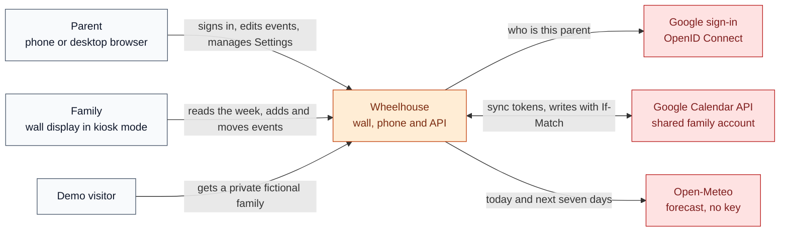
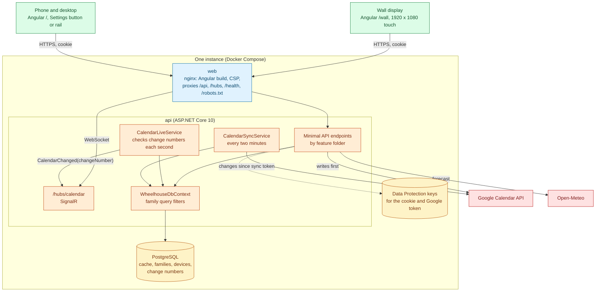
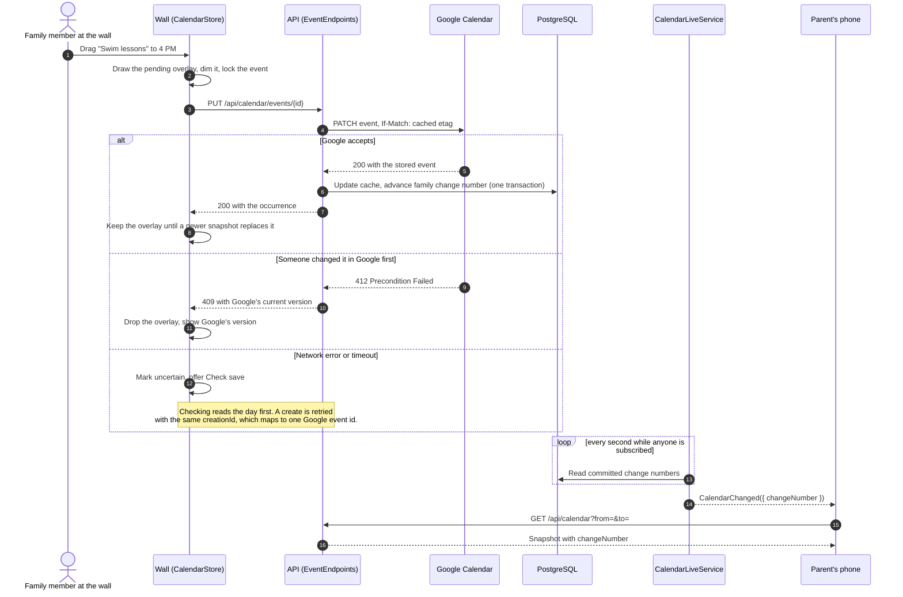

# Architecture

Wheelhouse is one ASP.NET Core API, one PostgreSQL database and one Angular app that draws two layouts: a wall display and a phone or desktop calendar. Google Calendar holds the family's events; the API keeps a cache of them and tells every open screen when that cache changes.

The diagrams use the same colors in every repository: people, the browser app, the server, data, delivery and outside services.

## System context

Who uses Wheelhouse and what it talks to.

The demo never calls Google. Each visitor gets a 24-hour copy of the fictional Marlowe family, seeded relative to the day it is made ([`Demo/DemoSeedData.cs`](../src/Wheelhouse.Api/Demo/DemoSeedData.cs)).

## Containers and runtime

What runs, and what calls what. Each instance (the demo, or one family) is its own Compose project with its own database.

- **Browser app.** State lives in root-provided stores under [`web/src/app/core/`](../web/src/app/core/) that expose read-only signals. [`CalendarStore`](../web/src/app/core/calendar.ts) keeps the last confirmed snapshot and draws pending edits over it; [`CalendarLive`](../web/src/app/core/calendar-live.ts) owns the single SignalR connection and a 30-second recovery check.
- **API.** Each feature folder (`Calendar`, `Families`, `Devices`, `Auth`, `Demo`, `Weather` and others) has a `MapX()` extension that [`Program.cs`](../src/Wheelhouse.Api/Program.cs) calls. Every endpoint needs a sign-in unless it opts out, and a test fails if the anonymous list changes.
- **Database.** Every family-owned table gets a query filter on the signed-in family ([`WheelhouseDbContext`](../src/Wheelhouse.Api/Data/WheelhouseDbContext.cs)), so a query that forgets the family returns nothing rather than another family's rows. See [ADR 0002](adr/0002-family-scoping-in-the-db-context.md).
- **Sign-in.** One encrypted cookie carries the family's id. Parents get it from Google sign-in, a wall display from a six-digit pairing code, and a demo visitor from `POST /api/demo/visit`. Each request re-checks the account or device, so removing one signs it out at once.

## Signature flow: an optimistic edit and its live notification

Dragging an event on the wall to a new time. The wall shows the change at once, Google decides whether it stands, and every other screen learns about it without polling for event data.

The pieces: [`EventEndpoints.cs`](../src/Wheelhouse.Api/Calendar/EventEndpoints.cs) writes to Google first, [`WheelhouseDbContext.CalendarChanges.cs`](../src/Wheelhouse.Api/Data/WheelhouseDbContext.CalendarChanges.cs) advances the change number in the same transaction as the cache, [`CalendarLiveService.cs`](../src/Wheelhouse.Api/Calendar/CalendarLiveService.cs) publishes it, and [`EventIdentity.cs`](../src/Wheelhouse.Api/Calendar/EventIdentity.cs) turns a client's `creationId` into a deterministic Google event id so a retried create cannot make a duplicate. See ADRs [0001](adr/0001-google-calendar-is-the-source-of-truth.md) and [0003](adr/0003-per-family-change-numbers.md).

## Delivery pipeline

Every merge to `main` is tested again and released unless it is held. The demo moves first and is checked in a browser before any family instance moves.

```mermaid
flowchart LR
  PR["Pull request"] --> CI
  subgraph CI["ci.yml"]
    ApiJob["api<br/>xUnit on real PostgreSQL<br/>(Testcontainers), deploy script tests"]
    WebJob["web<br/>Angular build, unit tests,<br/>Playwright at wall and phone sizes"]
    Stack["stack<br/>docker compose up, smoke check,<br/>edit, drag and series checks"]
  end
  CI --> Merge["Merge to main"]
  Merge --> Release
  subgraph Release["release.yml"]
    Retest["Run ci.yml again"] --> Tag{"Held?<br/>release:hold, [no release]<br/>or AUTO_RELEASE=off"}
    Tag -->|"no"| Version["Tag next version<br/>patch, or minor/major by label"]
    Version --> Images["Build api and web images<br/>to GitHub Container Registry"]
    Images --> Demo["Deploy demo instances<br/>snapshot, migrate, browser smoke"]
    Demo --> FamilyDeploy["Deploy family instances<br/>same checks"]
    FamilyDeploy --> Notes["GitHub release notes"]
  end
  Server[("Server<br/>nginx HTTPS, one Compose<br/>project per instance")]
  Backup[("Cloud Storage<br/>nightly dumps and keys")]
  Demo --> Server
  FamilyDeploy --> Server
  Server -.->|"nightly-backup.sh"| Backup

  classDef repo fill:#eef2ff,stroke:#4338ca,color:#312e81
  classDef delivery fill:#f3e8ff,stroke:#7e22ce,color:#581c87
  classDef server fill:#ffedd5,stroke:#c2410c,color:#7c2d12
  classDef data fill:#fef3c7,stroke:#b45309,color:#78350f
  class PR,Merge repo
  class ApiJob,WebJob,Stack,Retest,Tag,Version,Images,Demo,FamilyDeploy,Notes delivery
  class Server server
  class Backup data
```

The workflows are [`ci.yml`](../.github/workflows/ci.yml) and [`release.yml`](../.github/workflows/release.yml); the server side is [`deploy/release-phase.sh`](../deploy/release-phase.sh) and [`deploy/deploy.sh`](../deploy/deploy.sh). [deploy/README.md](../deploy/README.md) covers setting up a server and an instance.

## Source boundaries

| Path | Owns |
| --- | --- |
| `src/Wheelhouse.Api/Calendar/` | Google client, sync, the event endpoints, repeat rules, the SignalR hub and its publisher |
| `src/Wheelhouse.Api/Data/` | `WheelhouseDbContext`, family query filters, change numbers, migrations |
| `src/Wheelhouse.Api/Auth/`, `Devices/`, `Sessions/` | Google sign-in, display pairing, the cookie, rate limits and the same-origin check |
| `src/Wheelhouse.Api/Demo/` | Demo copies, their seed data and cleanup |
| `src/Wheelhouse.Api/Chores/`, `Lists/`, `Meals/` | Persistence shapes kept for existing data only (see [ADR 0005](adr/0005-calendar-first-scope-keeps-legacy-tables.md)) |
| `web/src/app/core/` | Stores, the calendar grid engine, family-zone day math, live connection |
| `web/src/app/wall/`, `home/`, `phone/`, `shared/` | The wall layout, the phone and desktop layout, Settings, and the details and editors both use |
| `web/e2e/`, `web/e2e-stack/` | Browser checks against stubbed responses, and against the real API and database |
| `deploy/` | Production Compose file, deploy, backup, restore and smoke scripts |

## Decisions

The reasoning behind the main choices is in [`docs/adr/`](adr/):

1. [Google Calendar is the source of truth](adr/0001-google-calendar-is-the-source-of-truth.md)
2. [Family scoping in the DbContext](adr/0002-family-scoping-in-the-db-context.md)
3. [Per-family change numbers for live updates](adr/0003-per-family-change-numbers.md)
4. [Demo copies that expire](adr/0004-demo-copies-that-expire.md)
5. [Calendar-first scope keeps the legacy tables](adr/0005-calendar-first-scope-keeps-legacy-tables.md)
